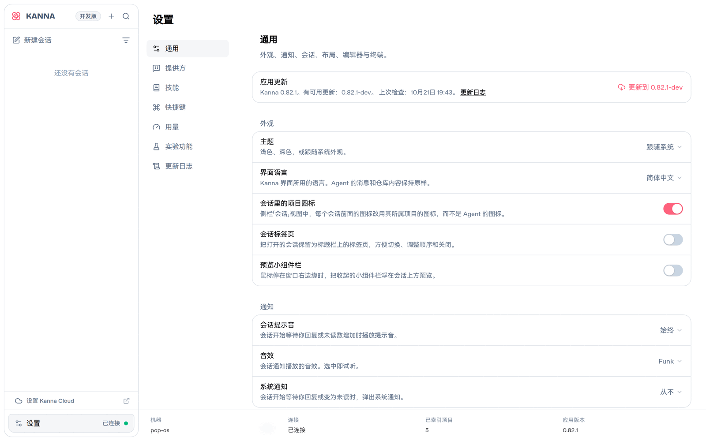
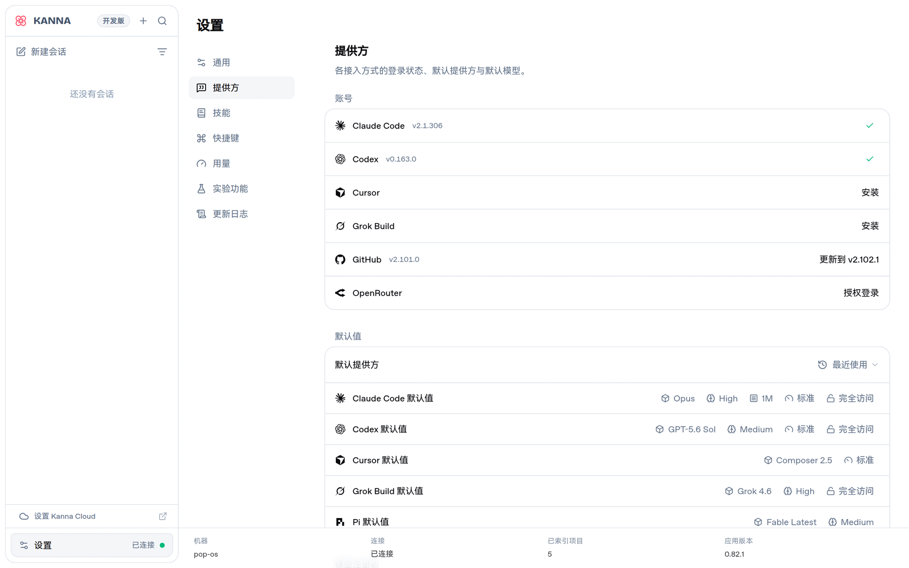
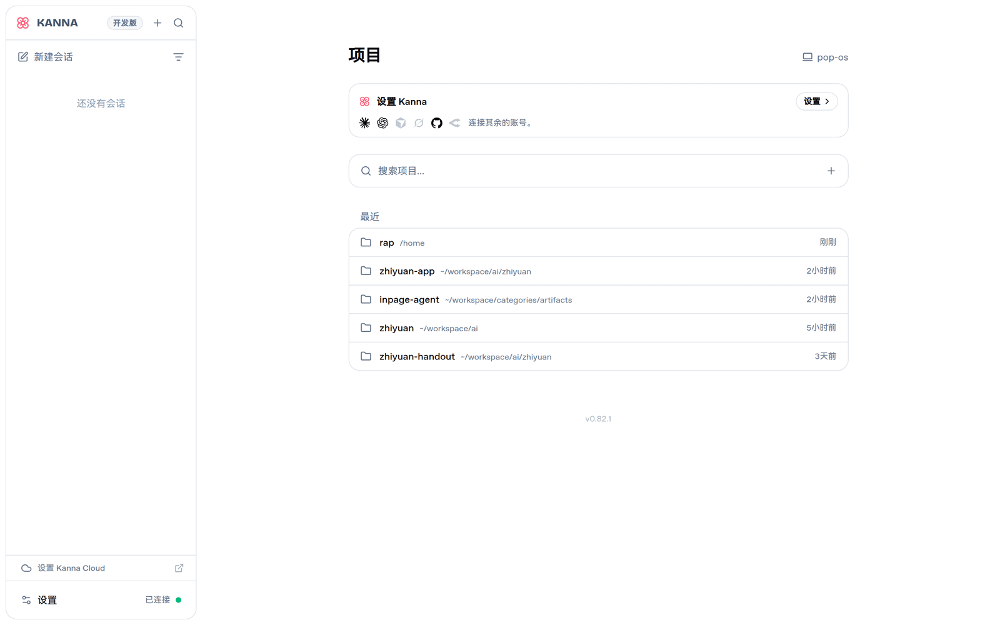
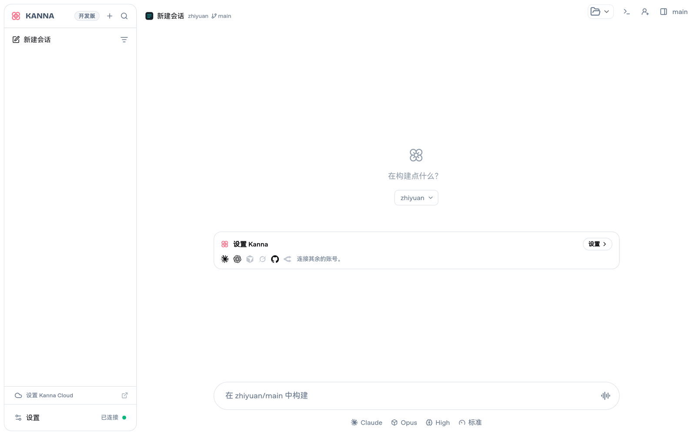
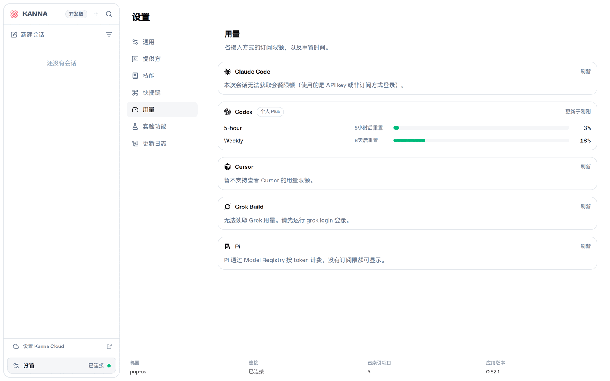
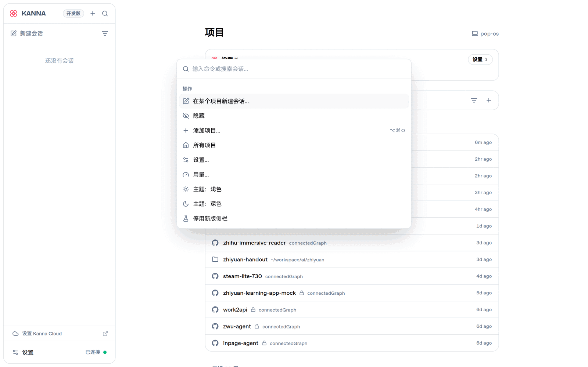
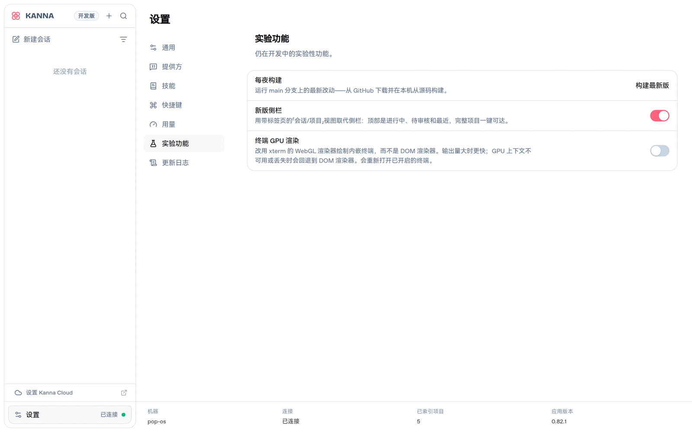

<p align="center">
  
</p>

<h1 align="center">Kanna</h1>

<p align="center">
  <strong>A beautiful web UI for the Claude Code & Codex CLIs</strong>
</p>

<p align="center">
  <a href="https://www.npmjs.com/package/kanna-code"></a>
</p>

<p align="center">
  <strong>简体中文汉化版 / Simplified Chinese localization</strong>
</p>

> **这是 [jakemor/kanna](https://github.com/jakemor/kanna) 的个人 fork，加了完整的简体中文界面。**
> 上游还没有 i18n（已提 [#151](https://github.com/jakemor/kanna/issues/151) 询问，暂无回复），
> 汉化改动全部在默认分支 `i18n-zh-cn` 上，跟着上游 `main` 走。
>
> 界面语言在 **设置 → 通用 → 界面语言** 切换，中英实时切换、无需重启。
> 英文仍是默认值 —— 不想要中文的话，这个 fork 跟原版没有区别。

<br />

<p align="center">
  <picture>
    <source media="(prefers-color-scheme: dark)" srcset="assets/screenshot.png" />
    <source media="(prefers-color-scheme: light)" srcset="assets/screenshot-light.png" />
    
  </picture>
</p>

<br />

## 中文界面 / Chinese UI

设置页、项目首页、新建会话、命令面板，全部取自本 fork 的实际运行界面（1440×900 @2x）。

<table>
  <tr>
    <td width="50%"></td>
    <td width="50%"></td>
  </tr>
  <tr>
    <td align="center"><sub>设置 · 通用（含界面语言选择器）</sub></td>
    <td align="center"><sub>设置 · 提供方</sub></td>
  </tr>
</table>

<table>
  <tr>
    <td width="50%"></td>
    <td width="50%"></td>
  </tr>
  <tr>
    <td align="center"><sub>项目首页：分组标题与相对时间「刚刚 / 2小时前 / 3天前」</sub></td>
    <td align="center"><sub>新建会话：空状态与输入框提示</sub></td>
  </tr>
</table>

<table>
  <tr>
    <td width="50%"></td>
    <td width="50%"></td>
  </tr>
  <tr>
    <td align="center"><sub>设置 · 用量（服务端下发的说明也已汉化）</sub></td>
    <td align="center"><sub>命令面板（⌘K）</sub></td>
  </tr>
</table>

<details>
<summary>更多截图</summary>

<p align="center">
  
</p>

</details>

<br />

## 安装这个 fork / Install this fork

从源码构建（本 fork 没有发布 npm 包）：

```bash
git clone -b i18n-zh-cn https://github.com/connectedGraph/kanna.git
cd kanna
bun install
bun run build
bun install -g .
```

装好后跟原版一样用：

```bash
kanna                 # 打开 http://localhost:3210
```

> 想跟上游一起装着不冲突，也可以直接 `bun run dev` 起开发服务，不用全局安装。

### 跟上游同步

```bash
git remote add upstream https://github.com/jakemor/kanna.git   # 首次
git fetch upstream
git rebase upstream/main
```

汉化的改动集中在 `src/shared/i18n/`、`src/client/i18n/` 和组件的 `t()` 调用上，
上游改到的文件如果正好有文案，rebase 时按 `docs/I18N.md` 的规则补 `t()` 即可 ——
**新文案漏翻不会报错，界面上会显示英文**，跑一次 `bun run i18n:coverage` 就能找出来。

## Quickstart

```bash
bun install -g kanna-code
```

If Bun isn't installed, install it first:

```bash
curl -fsSL https://bun.sh/install | bash
```

Then run from any project directory:

```bash
kanna
```

That's it. Kanna opens in your browser at [`localhost:3210`](http://localhost:3210).

## Features

- **Multi-provider support** — switch between Claude, Codex (OpenAI), Cursor, Grok Build, and Pi from the chat input, with per-provider model selection, reasoning effort controls, and Codex fast mode
- **Bundled Pi agent** — the [pi coding agent](https://github.com/badlogic/pi-mono) ships as a dependency and runs in-process through the Model Registry (Settings): point it at OpenRouter, OpenAI, or any custom OpenAI-compatible endpoint, pin fave models to the picker, and use any model id with standardized reasoning efforts — no local pi installation involved
- **Project-first sidebar** — chats grouped under projects, with live status indicators (idle, running, waiting, failed)
- **Drag-and-drop project ordering** — reorder project groups in the sidebar with persistent ordering
- **Local project discovery** — auto-discovers projects from both Claude and Codex local history
- **Rich transcript rendering** — hydrated tool calls, collapsible tool groups, plan mode dialogs, and interactive prompts with full result display
- **Quick responses** — lightweight structured queries (e.g. title generation) via Haiku with automatic Codex fallback
- **Plan mode** — review and approve agent plans before execution
- **Persistent local history** — refresh-safe routes backed by JSONL event logs and compacted snapshots
- **Auto-generated titles** — chat titles generated in the background via Claude Haiku
- **Session resumption** — resume agent sessions with full context preservation
- **WebSocket-driven** — real-time subscription model with reactive state broadcasting
- **Simplified Chinese UI** _(this fork)_ — every string the client renders, switchable in Settings, with English as a zero-catalog fallback

## 汉化实现 / How the localization works

**英文原文就是 key**，不是 `nav.chats` 这种语义 id：

```tsx
const t = useT()
<span>{t("New Chat")}</span>          // 中文表: "New Chat": "新建会话"
```

这样一来：

- **英文模式零词表依赖** —— 缺 key 时渲染 key 本身，正好是原来硬编码的英文
- **漏翻的地方退化成可读英文**，界面上不会露出 `settings.general.theme.label`
- **英文原文改了，key 跟着变** —— 译文显式失效（露出英文），而不是悄悄错位

```
src/shared/i18n/                 零依赖、无 React、无 Bun/node（src/shared 的规矩）
├── index.ts                     Locale / LOCALES / translate() / normalizeLocale()
├── zh-CN.ts                     汇总各分区
└── catalog/                     10 个分区，便于并行翻译、避免同文件冲突
    settings · messages · widgets · navigation · palette · git · misc · auth · chat · home
src/client/i18n/
├── catalogs.ts                  locale → 词表（React 无关，纯模块用 translatorFor()）
└── useT.ts                      useT() / useLocale()
```

**语言设置走现有 settings 通道**（`AppSettingsSnapshot.locale`），持久化、跨设备同步、
乐观更新全部免费获得。English 是默认值，**不写入配置文件**。

`useT()` 从 app-settings store 读 locale，不新建 React Context —— 组件和测试都不需要额外包 Provider。

### 覆盖范围

- **992 个 `t()` key，1095 条译文，覆盖率 100%**（`scripts/check-coverage.ts` 校验）
- 包含：设置页全部、侧栏、会话页头、输入框、命令面板、对话记录的消息行与工具卡片、
  git 面板、widget 列、项目首页、登录与引导向导、相对时间（「2小时前」）、
  服务端下发的用量说明
- 不包含：Agent 自己输出的内容（本来就不该翻）、服务端错误诊断信息、RTL 布局

### 加了新的界面文案？

```bash
bun run i18n:coverage        # 缺译文 / 无人使用的 key / 总数，有缺口退出码 1
bun test src/shared/i18n     # 词表一致性（跨区重复、值=key、全角标点）
```

术语表在 [`docs/I18N-GLOSSARY.md`](docs/I18N-GLOSSARY.md)（Chat→会话、Diff→差异、Agent 不译…），
改文案前先读；改码规范在 [`docs/I18N.md`](docs/I18N.md)。

## Architecture

```
Browser (React + Zustand)
    ↕  WebSocket
Bun Server (HTTP + WS)
    ├── WSRouter ─── subscription & command routing
    ├── AgentCoordinator ─── multi-provider turn management
    ├── ProviderCatalog ─── provider/model/effort normalization
    ├── QuickResponseAdapter ─── structured queries with provider fallback
    ├── EventStore ─── JSONL persistence + snapshot compaction
    └── ReadModels ─── derived views (sidebar, chat, projects)
    ↕  stdio
Claude Agent SDK / Codex App Server / cursor-agent / grok CLI (local processes)
    ↕
Local File System (~/.kanna/data/, project dirs)
```

**Key patterns:** Event sourcing for all state mutations. CQRS with separate write (event log) and read (derived snapshots) paths. Reactive broadcasting — subscribers get pushed fresh snapshots on every state change. Multi-provider agent coordination with tool gating for user-approval flows. Provider-agnostic transcript hydration for unified rendering.

## Requirements

- [Bun](https://bun.sh) v1.3.5+
- A working [Claude Code](https://docs.anthropic.com/en/docs/claude-code) environment
- _(Optional)_ [Codex CLI](https://github.com/openai/codex) for Codex provider support

Embedded terminal support uses Bun's native PTY APIs and currently works on macOS/Linux.

## Install

Install Kanna globally:

```bash
bun install -g kanna-code
```

If Bun isn't installed, install it first:

```bash
curl -fsSL https://bun.sh/install | bash
```

Or clone and build from source:

```bash
git clone https://github.com/jakemor/kanna.git
cd kanna
bun install
bun run build
```

## Usage

```bash
kanna                  # start with defaults (localhost only)
kanna --port 4000      # custom port
kanna --no-open        # don't open browser
kanna --password <secret>      # require a password before loading the app
kanna --share                # create a public quick tunnel + terminal QR
kanna --cloudflared <token>  # run a named Cloudflare tunnel from a token
```

Default URL: `http://localhost:3210`

### Network access (Tailscale / LAN)

By default Kanna binds to `127.0.0.1` (localhost only). Use `--host` to bind a specific interface, or `--remote` as a shorthand for `0.0.0.0`:

```bash
kanna --remote                     # bind all interfaces — browser opens localhost:3210
kanna --host dev-box               # bind to a specific hostname — browser opens http://dev-box:3210
kanna --host 192.168.1.x           # bind to a specific LAN IP
kanna --host 100.64.x.x            # bind to a specific Tailscale IP
```

When `--host <hostname>` is given, the browser opens `http://<hostname>:3210` automatically. Other machines on your network can connect to the same URL:

### Password protection

Use `--password` to require a launch password before the app or websocket can connect:

```bash
kanna --password my-secret
bun run dev --password my-secret
```

Kanna verifies the password once, then sets a browser-session cookie. The password itself is not stored in the browser.
When password protection is enabled, the backend requires authentication for API routes and `/ws`. The SPA shell still loads, `/health` remains public for restart detection, and the same in-app password screen is used in both dev and production.

### Public share link

Use `--share` to create a temporary public `trycloudflare.com` URL and print a terminal QR code:

```bash
kanna --share
kanna --share --port 4000
kanna --cloudflared <token>
```

`--share` is incompatible with `--host` and `--remote`. It does not open a browser automatically.

Without a token, it prints:

```text
QR Code:
...

Public URL:
https://<random>.trycloudflare.com

Local URL:
http://localhost:3210
```

With `--cloudflared <token>`, Kanna runs `cloudflared tunnel run --token <token> --url <local-url>`.
If Kanna can detect the public hostname from cloudflared output, it prints the same QR/public/local block.
If not, it keeps the tunnel running, warns that no public hostname was detected, and prints the local URL so you can use the hostname already configured for that tunnel in Cloudflare.

## Development

```bash
bun run dev
```

The same `--remote` and `--host` flags can be used with `bun run dev` for remote development.
`--share` is also supported in dev mode and exposes the Vite client URL publicly:

```bash
bun run dev --share
bun run dev --cloudflared <token>
bun run dev --port 3333 --share
```

In dev, `--port` sets the Vite client port and the backend runs on `port + 1`, so `bun run dev --port 3333 --share` publishes `http://localhost:3333`.
`--share` remains incompatible with `--host` and `--remote`.
Use `bun run dev --port 4000` to run the Vite client on `4000` and the backend on `4001`.

Or run client and server separately:

```bash
bun run dev:client   # http://localhost:5174
bun run dev:server   # http://localhost:5175
```

## Scripts

| Command              | Description                  |
| -------------------- | ---------------------------- |
| `bun run build`      | Build for production         |
| `bun run check`      | Typecheck + build            |
| `bun run dev`        | Run client + server together |
| `bun run dev:client` | Vite dev server only         |
| `bun run dev:server` | Bun backend only             |
| `bun run start`      | Start production server      |
| `bun test`           | Unit/integration tests       |
| `bun run i18n:coverage` | i18n key coverage + stale entries |
| `bun run test:e2e`   | Playwright browser smoke suite |

## Project Structure

```
src/
├── client/          React UI layer
│   ├── app/         App router, pages, socket client, useKannaState + feature hooks
│   │                (useChatCommands, useSendMessage, useAppSettingsSync,
│   │                useUpdateRestart, useShareExport, snapshotEquality)
│   ├── components/  Messages, chat chrome (incl. chat-ui/git/ panel modules),
│   │                dialogs, buttons, inputs
│   ├── hooks/       Theme, standalone mode detection
│   ├── stores/      Zustand stores (chat input, preferences, project order)
│   └── lib/         Formatters, path utils, transcript parsing, storage keys
├── server/          Bun backend
│   ├── cli.ts       CLI entry point & browser launcher
│   ├── server.ts    HTTP/WS server setup & static serving
│   ├── agent.ts     AgentCoordinator (multi-provider turn management)
│   ├── codex-app-server.ts  Codex App Server JSON-RPC client
│   ├── cursor-cli.ts / pi-agent.ts  Cursor and Pi provider adapters
│   ├── provider-catalog.ts  Provider/model/effort normalization
│   ├── quick-response.ts    Structured queries with provider fallback
│   ├── ws-router.ts WebSocket command routing & snapshot subscriptions
│   ├── skills.ts    Skill search/install/uninstall
│   ├── event-store.ts  JSONL persistence, replay & compaction
│   ├── discovery.ts Auto-discover projects from Claude and Codex local state
│   ├── read-models.ts  Derive view models from event state
│   └── events.ts    Event type definitions
└── shared/          Shared between client & server
    ├── types.ts     Core data types, provider catalog, transcript entries
    ├── tools.ts     Tool call normalization and hydration
    ├── protocol.ts  WebSocket message protocol
    ├── ports.ts     Port configuration
    ├── branding.ts  App name, data directory paths
    └── i18n/        translate(), locale list, and the zh-CN catalog by area

e2e/                 Playwright smoke suite (boots the real server)
```

## Data Storage

All state is stored locally at `~/.kanna/data/`:

| File             | Purpose                                   |
| ---------------- | ----------------------------------------- |
| `projects.jsonl` | Project open/remove events                |
| `chats.jsonl`    | Chat create/rename/delete events          |
| `messages.jsonl` | Transcript message entries                |
| `turns.jsonl`    | Agent turn start/finish/cancel events     |
| `snapshot.json`  | Compacted state snapshot for fast startup |

Event logs are append-only JSONL. On startup, Kanna replays the log tail after the last snapshot, then compacts if the logs exceed 2 MB.

## Star History

<a href="https://www.star-history.com/?repos=jakemor%2Fkanna&type=date&legend=top-left">
 <picture>
   <source media="(prefers-color-scheme: dark)" srcset="https://api.star-history.com/image?repos=jakemor/kanna&type=date&theme=dark&legend=top-left" />
   <source media="(prefers-color-scheme: light)" srcset="https://api.star-history.com/image?repos=jakemor/kanna&type=date&legend=top-left" />
   
 </picture>
</a>

## Contributing

Contributions are welcome! Feel free to open PRs

## License

[MIT](LICENSE)
